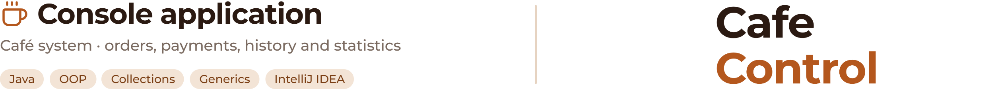
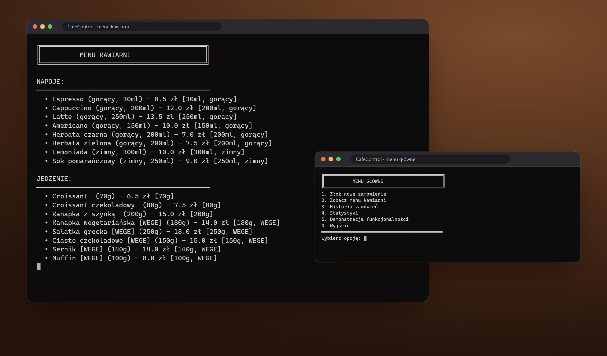
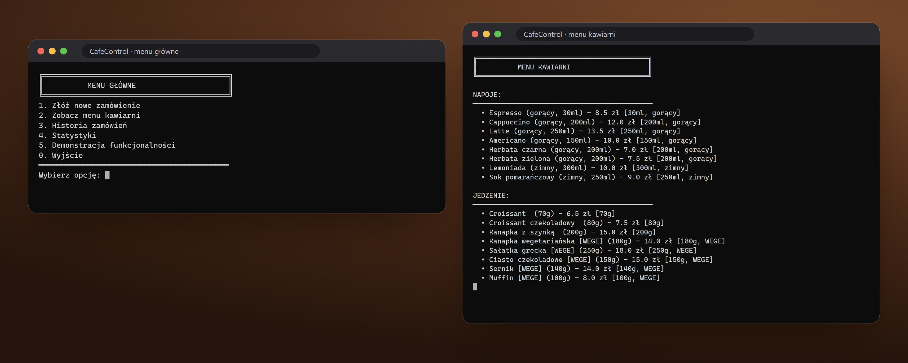

<p align="center">
  <picture>
    <source media="(prefers-color-scheme: dark)" srcset="docs/images/banner-dark.png">
    
  </picture>
</p>

<p align="center">
  
</p>

## About

**CafeControl** is a console system for running a café, written in Java for the *Java Programming* course (a team
project of four). It manages customers, employees, the menu, orders and payments from an interactive menu driven by
the keyboard (`Scanner`).

- **Orders.** Build an order from the menu (add and remove products), show it, finalise it or cancel it. Five order
  statuses, validated order items and a custom `InvalidOrderException`.
- **Menu of 16 products.** Drinks (temperature, volume) and food (weight, vegetarian flag) share the abstract
  `Product`.
- **Payments.** Cash, card, mobile and voucher (`PaymentMethod` enum).
- **History and statistics.** The order history sorts by ID or by value (`Comparable` and `Comparator`); sales and
  revenue statistics.
- **Built to a course brief.** The project demonstrates what the course asked for: two inheritance hierarchies
  (`Person` → `Customer`, `Employee`; `Product` → `Drink`, `Food`), abstract classes and methods, encapsulation,
  `toString` / `equals` / `hashCode`, interfaces, enums, collections, a generic method, static fields and methods,
  upcasting and downcasting. A "demonstration" entry of the menu walks through them.

> **Status:** a finished course project. The interface texts are in Polish; there are no automated tests, the
> functionality is exercised from the menu.

## Team

Team project, *Java Programming*:

| Member              | Work                                                                                                    |
| ------------------- | ------------------------------------------------------------------------------------------------------- |
| Damian Tchorzewski  | project structure (packages, classes, repository), `Main`; final tests and documentation                |
| Krzysztof Katana    | model classes: `Person`, `Customer`, `Employee`, `Product`, `Drink`, `Food`                             |
| Maciej Stefaniuk    | orders and exceptions (`Order`, `OrderItem`, `Payment`, `OrderStatus`); user interaction layer (`Scanner`, menu, loops) |
| Eryk Możdżyński     | `Comparable` and `Comparator`, the generic sorting method, enums, static fields and methods             |

## Tech stack

|        |                                                                                       |
| ------ | ------------------------------------------------------------------------------------- |
| Stack  | Java (JDK 21 or newer; the IntelliJ project is set to OpenJDK 25), standard library only |
| UI     | console, keyboard input with `Scanner`                                                |
| Tests  | none; a demonstration entry in the menu                                               |
| IDE    | IntelliJ IDEA (`.idea/` and `CafeControl.iml` are in the repository)                  |

The interface texts are Polish; identifiers, commits and branches are in English.

## Screenshots

<p align="center">
  
</p>

These screens are not a recording of a run: no JDK 21 was available to run the program, so
`tools/projects/CafeControl/make-transcripts.mjs` assembles them from `src/Main.java` (the same strings, the 16
products of `getDefaultMenu` and the formats of `getDescription`) and `tools/readme-images` draws them. The texts are
Polish. What a user types (a customer's name, an order) is not shown, because it would be made up. While an order is
open the program offers: add a product, remove a product (`2`), show the current order (`3`), finalise it (`4`) or
cancel it (`0`); the history sorts by order ID or by order value, ascending.

## Quick start

```bash
git clone https://github.com/DamTchorzewski/CafeControl.git
cd CafeControl
javac -d out src/Main.java
java -cp out Main
```

Requirements: JDK 21 or newer. Or open the folder in IntelliJ IDEA and run `Main.main()`. `javac` compiles the
other packages together with `Main`, which uses them.

## Scripts

There is no build tool (no Maven or Gradle); the commands above compile and run the program.

| Command                          | What it does                    |
| -------------------------------- | ------------------------------- |
| `javac -d out src/Main.java`     | compile `Main` and what it uses |
| `java -cp out Main`              | start the application           |

## Configuration

None: no environment variables, keys or files; the data (menu, customers, orders) lives in memory for the length of
one run.

## Structure

```
src/Main.java            ★ entry point: the menu, orders, history, statistics, the demonstration
src/model/               Person (abstract), Customer, Employee, Product (abstract), Drink, Food
src/order/               Order, OrderItem, Payment (with PaymentMethod), OrderStatus (enum)
src/interfaces/          IUserInterface, IOrderHandler
src/util/                ArrayUtils (generic method), SortUtils
src/exception/           InvalidOrderException
docs/                    documentation; docs/images/ holds the README images (generated)
```

## Branches and workflows

Shared standards from `reops/standards`: `main` ≤ `develop` ≤ a working branch `<type>/<topic>`, fast-forward
merges, Conventional Commits in English. The repository has no workflows.

**Departures from the standards (and why):**

- **Default branch is `master`**, not `main`: the repository was created that way; renaming it is a GitHub
  setting for the owner. The local `develop` is cut from `master`.
- **No "Open site" button, no phone strip, no CI, no hooks:** a console project with no site and no toolchain beyond the
  JDK. The images are terminal windows assembled from the source (see Screenshots) and the logo is a wordmark.
- **No company branding in the footer:** a university team project, with several authors.
- **Interface texts in Polish:** the course and its readers are Polish.

## Documentation

| Document                                   | Covers                                              |
| ------------------------------------------ | --------------------------------------------------- |
| [docs/repository.md](docs/repository.md)   | GitHub description and topics                       |
| [docs/requirements.md](docs/requirements.md) | the course brief and how each requirement is met  |

The README images (`docs/images/`) are regenerated with `tools/readme-images` (profile `CafeControl`), after
`make-transcripts.mjs` has built the screens; the working shots go to `.scratch/`.

---

Author: [Damian Tchorzewski](https://github.com/DamTchorzewski)
